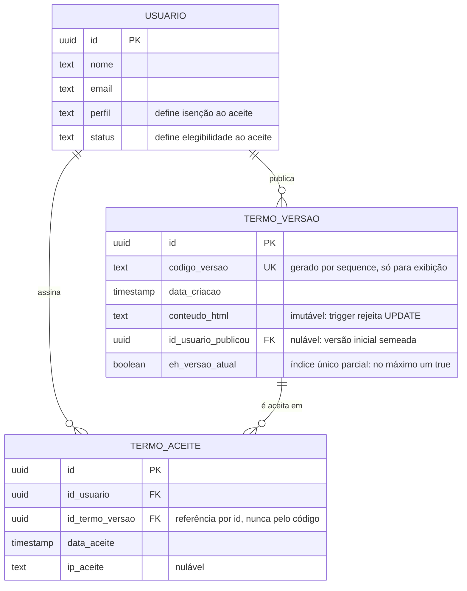

[← voltar ao início](../README.md) · [← 03 — Decisões técnicas](03-decisoes-tecnicas.md)

# 04 — Modelo de dados

> Modelo conceitual. Nomes de tabela e coluna aqui são ilustrativos — o ponto deste documento são as **invariantes**, não o schema literal.

---

## Diagrama

---

## Duas tabelas, dois comportamentos opostos

| | `termo_versao` | `termo_aceite` |
|---|---|---|
| **Natureza** | Catálogo de documentos publicados | Livro de assinaturas |
| **Escrita** | Insert na publicação; um único update permitido (desmarcar como vigente) | Insert apenas |
| **Conteúdo** | Imutável após insert | Imutável após insert |
| **Exclusão** | Possível, com restrições (ver abaixo) | Nunca |
| **Na entidade de domínio** | Método de fábrica + método para desmarcar como vigente | Apenas método de fábrica — nenhum outro método público |

A tabela de aceites **não expõe nenhuma operação além da criação**. Não é uma convenção que alguém precisa lembrar: não existe código capaz de alterá-la.

---

## As invariantes, e onde cada uma mora

| Invariante | Garantida por | Por que ali |
|---|---|---|
| O conteúdo de uma versão publicada nunca muda | **Trigger** rejeitando `UPDATE` na coluna | Precisa valer inclusive para `UPDATE` manual. Ver [ADR-02](03-decisoes-tecnicas.md#adr-02--imutabilidade-garantida-pelo-banco-não-pelo-código) |
| No máximo uma versão vigente | **Índice único parcial** sobre a coluna de vigência | Mesma razão: é uma verdade do dado, não uma política da aplicação |
| Um usuário não registra o mesmo aceite duas vezes | **Restrição de unicidade** em (usuário, versão) | Reenvio de requisição e duplo clique não podem virar dois registros |
| O código da versão é único e sequencial | **Sequence** do banco | Atômica sob concorrência. Ver [ADR-05](03-decisoes-tecnicas.md#adr-05--código-da-versão-vem-de-sequence-do-banco) |
| O conteúdo tem tamanho sensato | **Validação na entidade**, depois da sanitização | É regra de domínio com um número escolhido por julgamento, não uma verdade estrutural. Ver [ADR-03](03-decisoes-tecnicas.md#adr-03--dois-tetos-de-tamanho-por-irreversibilidade-não-por-performance) |
| Publicar troca a vigência sem estado intermediário | **Transação** cobrindo insert da nova e update da anterior | Duas vigentes, ou nenhuma, são estados que a aplicação inteira assume impossíveis |

A linha divisória que orientou essas escolhas: **o que não admite exceção vai para o schema; o que depende de julgamento fica no código.**

O tamanho do conteúdo é um número escolhido — pode mudar amanhã por decisão de produto. "Só existe uma versão vigente" não é escolha, é definição. Por isso uma está em validação e a outra em índice.

---

## A referência entre aceite e versão

O aceite referencia a versão **pelo identificador único**, nunca pelo código legível.

O código existe para aparecer na tela. Se a referência fosse por ele, uma mudança na forma de gerar códigos — ou um código reaproveitado — quebraria o vínculo entre a assinatura e o documento assinado.

Combinada com a imutabilidade do conteúdo, essa referência significa que **é sempre possível recuperar exatamente o texto que um usuário aceitou**, em qualquer momento. É isso que torna a trilha auditável e não apenas registrada.

---

## Migração a partir do estado anterior

A base existente tinha o aceite como campo sobrescrito, sem histórico. Dois passos:

1. **Semear a versão inicial** — o texto que estava no código-fonte virou a primeira linha da tabela de versões, marcada como vigente. Publicada sem usuário responsável, porque não houve publicação: houve origem. Daí a coluna de autor ser nulável.
2. **Converter os aceites existentes** — quem já havia aceitado no modelo antigo recebeu uma linha na tabela de aceites, apontando para a versão semeada.

Sem o passo 2, todo mundo seria cobrado de novo no login seguinte à entrega — um reaceite em massa causado pela própria migração, pedindo aos usuários que assinassem outra vez exatamente o documento que já tinham assinado.

A data de aceite dos registros convertidos é a melhor aproximação disponível a partir do modelo antigo, não a data real da assinatura original. **É uma perda de fidelidade, conhecida e aceita** — o modelo antigo não guardava essa informação, então não havia o que recuperar. Vale registrar porque uma auditoria futura sobre os aceites mais antigos precisa saber disso.

---

## Exclusão de versão

Existe, mas não no admin: é endpoint de uso operacional, sem botão em tela.

As restrições:

- **Recusa excluir a versão vigente.** Deixaria o sistema sem documento a exigir.
- **Recusa excluir versão com aceites registrados.** Garantido pela chave estrangeira — apagar a versão apagaria o documento que alguém assinou.
- **Não é exclusão lógica.** A auditoria guarda um snapshot do conteúdo antes de excluir, porque é a única forma de recuperar o texto depois.

Na prática, só é possível excluir uma versão publicada por engano e ainda não aceita por ninguém — exatamente o caso que a restrição deveria permitir.

---

[← 03 — Decisões técnicas](03-decisoes-tecnicas.md) · [→ 05 — Fluxos](05-fluxos.md)
