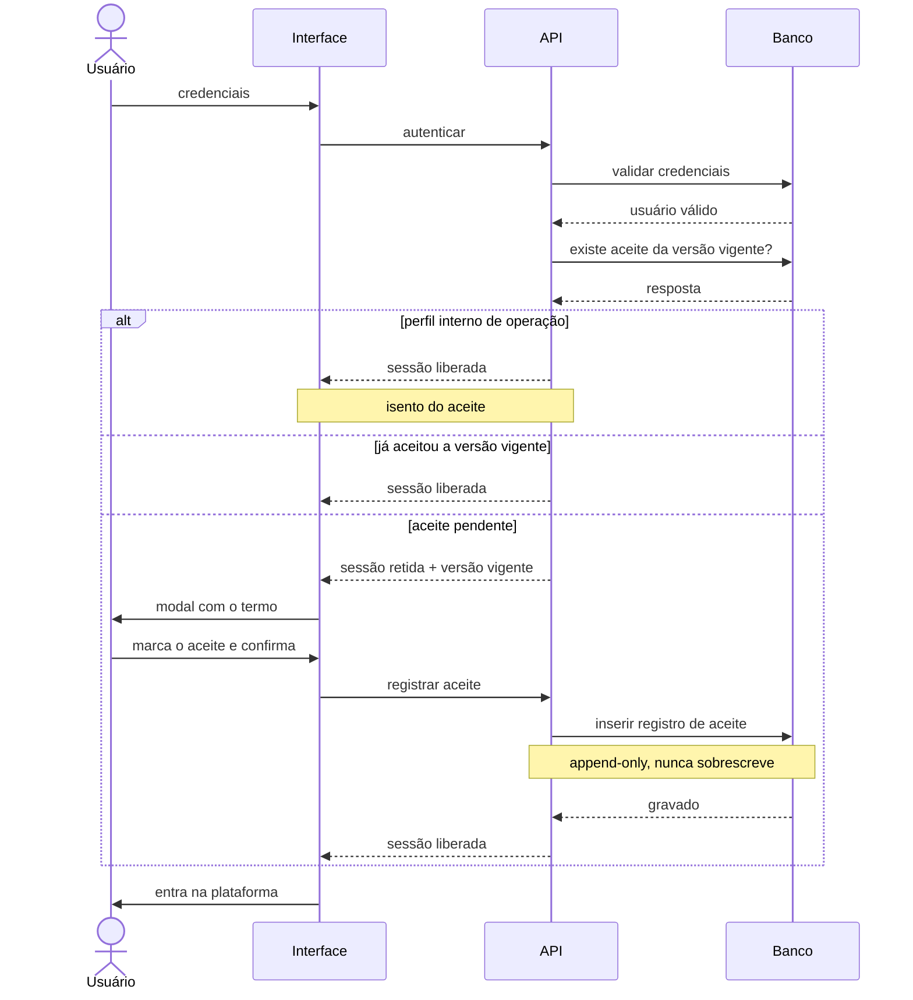
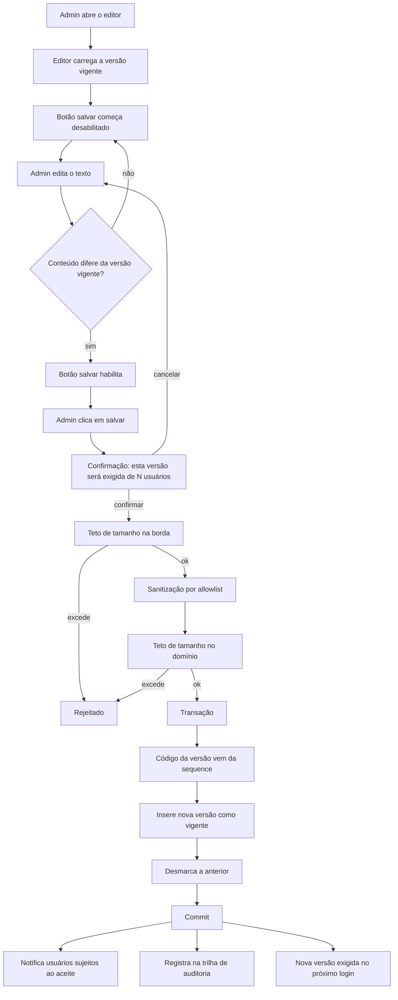
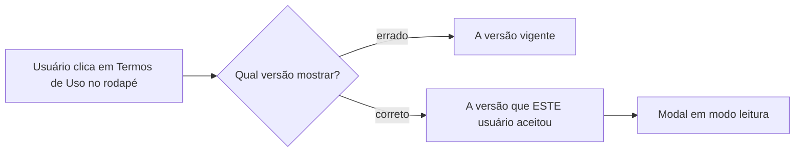

[← voltar ao início](../README.md) · [← 04 — Modelo de dados](04-modelo-de-dados.md)

# 05 — Fluxos

Três fluxos sustentam a solução inteira. O primeiro é o que o usuário comum encontra, o segundo é o que o administrador faz, o terceiro é o detalhe que quase passou despercebido.

---

## 1. Login com aceite pendente

A barreira. É aqui que a publicação de uma nova versão produz efeito.

**O que a estrutura do diagrama já diz:**

- A verificação acontece **depois** da validação de credenciais. Quem não é quem diz ser nunca chega à pergunta do aceite.
- O ramo de isenção é o primeiro. Perfis internos de operação não são barrados — ver [RN08](02-regras-de-negocio.md#rn08--a-elegibilidade-ao-aceite-é-uma-regra-só-usada-em-todos-os-lugares).
- A sessão só é liberada **depois** do registro do aceite. Não existe estado "entrou mas ainda não aceitou".
- O aceite é um `insert`. O registro anterior do mesmo usuário, em outra versão, continua lá.

**O que o diagrama não mostra, e é decisão:** quem já está com sessão aberta no momento da publicação **não passa por aqui**. Não é interrompido. O aceite é cobrado no próximo login — ver [RN05](02-regras-de-negocio.md#rn05--a-nova-versão-é-exigida-a-partir-do-próximo-login).

---

## 2. Publicação de uma nova versão

Onde mora a fricção deliberada da [RN03](02-regras-de-negocio.md#rn03--salvar-só-habilita-se-houve-mudança-real-e-publicar-exige-confirmação-explícita).

**Leitura do fluxo:**

- **Três portas antes do banco.** Diferença de conteúdo, teto na borda, teto no domínio — e a sanitização entre os dois tetos, que é o motivo de serem dois. Ver [ADR-03](03-decisoes-tecnicas.md#adr-03--dois-tetos-de-tamanho-por-irreversibilidade-não-por-performance).
- **Cancelar volta para a edição, não descarta.** O trabalho do admin não se perde por hesitar na confirmação.
- **Desfazer até o texto original desabilita o botão de novo.** O laço de `E` para `C` é literal: a comparação é com o conteúdo, não com "houve digitação".
- **A transação cobre insert e update.** Nunca duas versões vigentes, nunca nenhuma — [RN04](02-regras-de-negocio.md#rn04--publicar-troca-a-versão-vigente-em-uma-operação-só).
- **Notificação e auditoria acontecem depois do commit.** Uma falha ao enviar e-mail não desfaz uma publicação válida.

---

## 3. Consulta pelo rodapé

O detalhe que quase passou despercebido, e que é o mais fácil de errar.

**Por que o caminho óbvio está errado.**

O instinto é mostrar o documento vigente — é o atual, é o certo, é o que o site exibe. Mas o documento que **vincula** aquele usuário é o que ele assinou.

Os dois casos em que isso importa:

1. **Usuário com sessão aberta durante uma publicação.** Pela [RN05](02-regras-de-negocio.md#rn05--a-nova-versão-é-exigida-a-partir-do-próximo-login), ele não foi interrompido e ainda não aceitou a nova versão. Mostrar a vigente seria exibir um contrato que não se aplica a ele — e sem que ele tenha sido avisado da troca.
2. **Auditoria ou disputa.** A pergunta correta nunca é "o que o termo diz hoje", é "o que o termo dizia quando esta pessoa concordou com ele". Essa é a pergunta que o sistema anterior não conseguia responder — ver [01 — O problema](01-problema.md#2-o-aceite-era-um-campo-não-um-histórico).

É um caso de feature correta que, construída do jeito intuitivo, reintroduziria silenciosamente o problema que a entrega inteira existia para resolver.

---

[← 04 — Modelo de dados](04-modelo-de-dados.md) · [→ 06 — Critérios de aceite e QA](06-qa.md)
